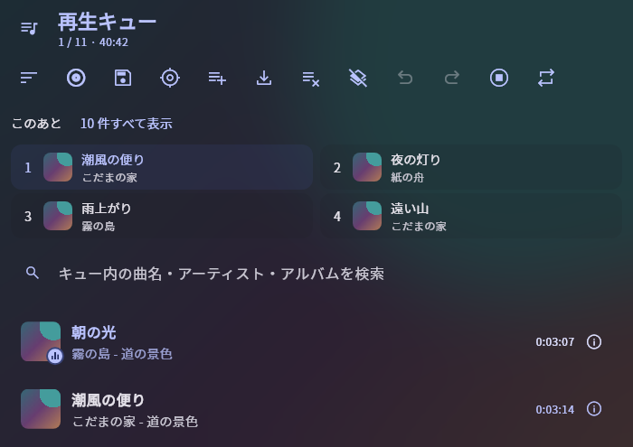
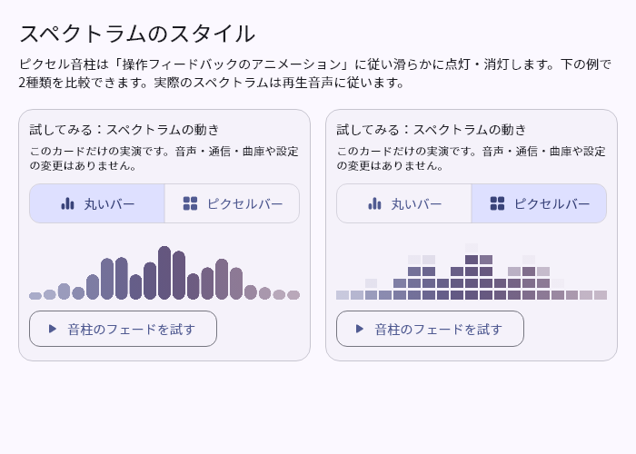
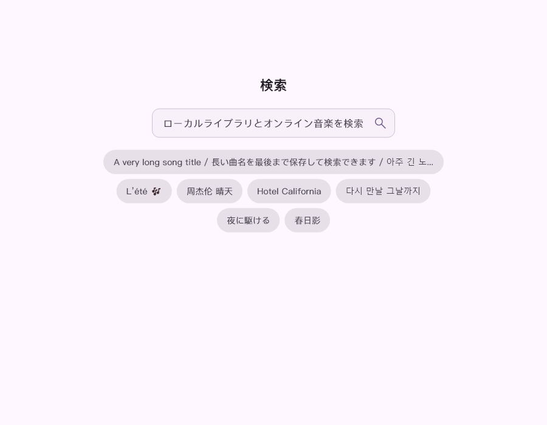
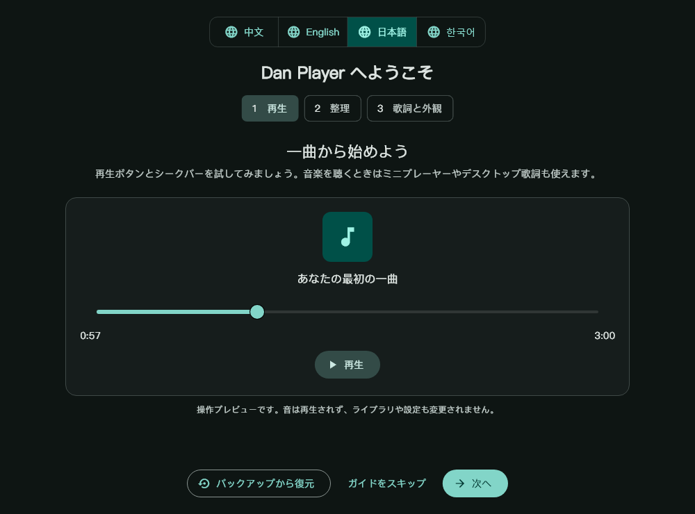
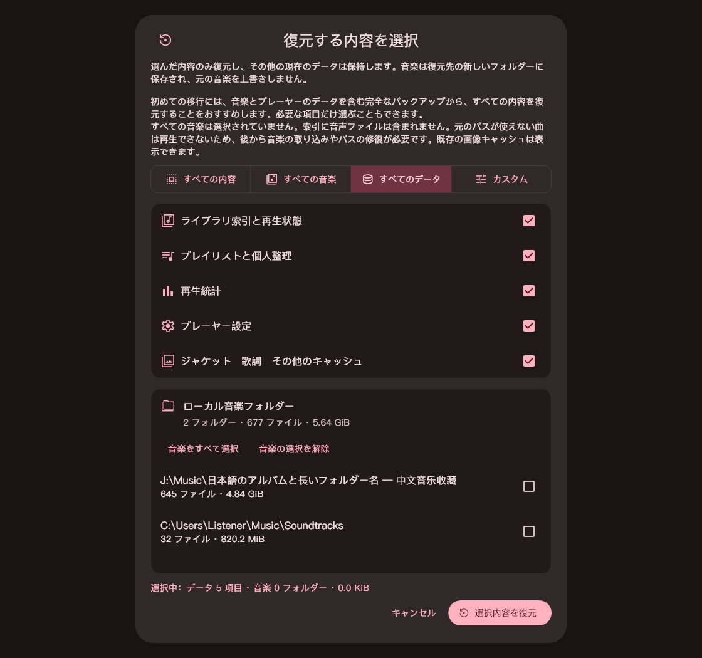

<div align="center">

<p>
  <picture>
    <source media="(prefers-color-scheme: dark)" srcset="docs/images/player-icon-dark.png">
    <source media="(prefers-color-scheme: light)" srcset="docs/images/player-icon-light.png">
    
  </picture>
</p>

<h1>Dan Player</h1>

<p><strong>ローカルの音楽コレクションのために。</strong></p>

<p>ライブラリ整理、歌詞表示、デスクトップでの操作にこだわった Windows x64 向け音楽プレーヤー。<br>
ローカル再生を中心に、オンライン音楽やカスタムソースも利用できます。</p>

<p align="center">
  <a href="https://github.com/DanRuguo/dan_player/releases/latest"></a>
  <a href="https://github.com/DanRuguo/dan_player/releases"></a>
  <a href="https://github.com/DanRuguo/dan_player/releases"></a>
  <a href="LICENSE"></a>
</p>

<p align="center">
  <a href="#download"></a>
  <a href="#development"></a>
  <a href="#development"></a>
  <a href="https://www.un4seen.com/bass.html"></a>
</p>

<p>
  <a href="https://github.com/DanRuguo/dan_player/releases/latest"><strong>安定版をダウンロード</strong></a> ·
  <a href="https://github.com/DanRuguo/dan_player/releases">過去のリリース</a> ·
  <a href="https://github.com/DanRuguo/dan_player/releases">更新内容</a> ·
  <a href="https://github.com/DanRuguo/dan_player/issues/new/choose">問題を報告</a>
</p>

<p>
  <a href="README.md">简体中文</a> ·
  <a href="README.en.md">English</a> ·
  <strong>日本語</strong> ·
  <a href="README.ko.md">한국어</a>
</p>

</div>

<p align="center">
  <picture>
    <source media="(prefers-color-scheme: dark)" srcset="docs/images/library-dark-wide.png">
    <source media="(prefers-color-scheme: light)" srcset="docs/images/library-light-wide.png">
    
  </picture>
</p>

<p align="center">
  <a href="#download">ダウンロード</a> ·
  <a href="#features">特長</a> ·
  <a href="#screenshots">インターフェース</a> ·
  <a href="#quick-start">使い始める</a> ·
  <a href="#development">開発とビルド</a>
</p>

<a id="download"></a>

## ダウンロードとインストール

| バージョン | 用途 | ダウンロード |
| --- | --- | --- |
| **最新安定版** | 日常利用と更新。バージョンはリリースページで確認 | [インストーラー・ポータブル ZIP・チェックサム](https://github.com/DanRuguo/dan_player/releases/latest) |

**インストーラー版**はセットアップを実行してください。既存のインストールを更新できます。**ポータブル版**は ZIP 全体を展開して `Dan Player.exe` を起動してください。EXE だけを取り出さないでください。デスクトップ歌詞は同じ実行ファイルから別プロセスとして起動します。

現在のポータブル ZIP には FFmpeg、3つのオフライン日本語読みデータ（主辞書・語彙補完・漢字読み補完）とライセンスを同梱し、試聴・音声切り出し・オフラインの読み生成に利用できます。軽量インストーラーにはこの2種類のコンポーネントを含めず、導入済みのものは保持します。プレーヤーから手動で取得する際も固定サイズと SHA-256 を検証します。FFmpeg は [26.0.5 の独立パッケージ](https://github.com/DanRuguo/dan_player/releases/tag/v26.0.5)、読みデータは [26.1.1 のリリースページ](https://github.com/DanRuguo/dan_player/releases/tag/v26.1.1)から個別に取得できます。

> **ダウンロードと署名について**：本プロジェクトの実行ファイルには RCEIT.Inc の自己署名証明書を使用しているため、Windows に信頼性の警告が表示される場合があります。インストーラーが信頼済み証明書を自動で登録することはありません。古い署名のバージョンから更新する場合は、新しいインストーラーを手動でダウンロードしてください。プレビュー版は Latest の安定版を置き換えません。更新前に、アプリのバックアップと復元設定から個人データを保存することをおすすめします。

<a id="download-verification"></a>

<details>
<summary><strong>SHA-256 でダウンロードしたファイルを確認する</strong></summary>

同じ Release からプログラムと対応するチェックサムを取得します。ポータブル ZIP は `SHA256SUMS`、インストーラーは同名の `.exe.sha256` と照合してください。ファイルの SHA-256 を計算し、GitHub のアセットダイジェストとも確認します。以下のファイル名は実際のものに置き換えてください。

```powershell
Get-FileHash -LiteralPath '.\DanPlayer-VERSION-Setup-x64.exe' -Algorithm SHA256
```

ハッシュの一致は公開アセットと同じ内容であることを示しますが、Windows が署名証明書を信頼することとは別です。入手元を確認し、不明なファイルを実行するためにシステムのセキュリティ機能を無効にしないでください。

</details>

<a id="features"></a>

## 特長

- **ライブラリと検索：** アーティスト・アルバム・形式・フォルダー別の閲覧、複数語・ピンイン・入力ミスに対応した検索、CUE 分割、複数ディスクの曲順、メタデータ一括編集、ライブラリの状態確認。
- **プレイリストとキュー：** 階層型・スマートプレイリストとドラッグ整列。キューの複数選択、Shift による範囲選択、検索結果の選択に対応し、次の曲・末尾への一括移動、削除、保存、書き出しができます。現在の再生を維持し、取り消し・やり直しにも対応。M3U／M3U8／PLS／XSPF のローカル音声参照を取り込めます。
- **音声の一括書き出し：** 音楽フォルダーの書き出しで、元ファイルのコピーまたは MP3／Opus／FLAC への変換を選べます。音質プリセット、CUE 分割、進捗表示、キャンセルに対応し、順序と重複を保った相対パスの M3U8 を生成します。変換では基本的な文字タグを保持し、元ファイルは変更しません。埋め込み画像・歌詞・サイドカーファイルは移行しません。変換には FFmpeg が必要です。
- **次に再生する曲：** 最大4曲を半透明カードで表示し、広い画面は2列、狭い画面は1列に。クリックでキュー内の該当項目へ移動し、展開すると再生順が確定した最大10曲を確認できます。設定は歌詞画面のプレビューだけに適用し、再生バーのポップアップには表示しません。
- **再生と区間：** イコライザー、音量の均一化、独立した音程変更、音程を保つ速度変更、曲ごとの再開、A–B リピート、全曲のブックマーク。クロスフェード、同一アルバムでのクロスフェード無効化、曲頭・曲末の無音スキップを選べます。
- **歌詞の編集と表示：** 単語の強調、翻訳、日本語ルビ、全文検索、時刻調整。タップ編集とテキスト編集、改訂・ロック、長い行のルビ配置に対応します。
- **ジャケットと分類：** 埋め込み画像・同じフォルダーの画像・アニメーション GIF に対応。大きなジャケットには柔らかな輪郭の光、局所的な水滴屈折、タップ時の波紋を表示し、単色部分では見た目が変わらない描画を省きます。分類タイルには光の演出・複数サイズ・自由な並べ替えを用意しています。
- **スペクトラムと動き：** シークバーとジャケット周囲に丸いバーまたは滑らかに変化するピクセル表示。10種類のアニメーション設定、動きの軽減、非表示時の停止、描画頻度と省電力設定を備え、操作ガイドでジャケットの効果・スペクトラム・再生位置・歌詞を試せます。
- **デスクトップ操作：** 4言語、明暗テーマ、ジャケットに合わせた配色、ショートカット、ミニプレーヤー。デスクトップ／タスクバー歌詞の単語強調、タスクバーの1行・2行表示と再生ボタンに対応し、両歌詞表示は切り替えて使います。
- **統計と個人整理：** 評価、個人タグ、再生ランキングに加え、直近90日間の完了した日付から曜日別の傾向を表示。合計時間と聴いた日あたりの平均を切り替えられます。コンピレーションはアルバムアーティストで分類し、音楽・キャッシュ別の集計、フォルダーのメモ、容量内訳、任意の CPU／GPU／メモリ監視も利用でき、ガイドではキューの複数選択・移動・取り消しを試せます。
- **バックアップと復元：** 音楽、ライブラリ、プレイリスト、統計、設定、キャッシュを選んで `.bak` に保存。暗号化、選択復元、キャンセルに対応し、共有する音楽ファイルは重複保存しません。

歌詞とコメントは標準でローカル内容とキャッシュを優先します。自動通信は設定で有効にでき、手動検索・更新・一括キャッシュでも通信が発生します。

オンライン音楽やカスタムソースも、ローカルでの再生を補う機能として利用できます。カスタムサービスは、明示的に宣言した機能に応じて検索や歌詞などを提供します。接続方法は[カスタム音楽ソース API](docs/custom-music-source-api.md)をご覧ください。

メイン・デスクトップ・タスクバーの歌詞は字間を共有します。生成した読みは漢字の位置にルビで表示し、原歌詞や既存の読みを保持して、独立した派生キャッシュに保存します。保存済み歌詞の一括処理も設定から利用できます。自動通信が有効ならオンラインを優先し、失敗時はオフラインへ切り替えます。無効なら読書ツールや一括処理画面でオンライン／オフラインを明示的に選びます。オンライン生成にはご自身の Yahoo! JAPAN Client ID が必要で、対象テキストを同サービスへ送信します。認証情報はこの PC にのみ保存します。 オフライン辞書では未知語・人名・複数の読みを持つ語を正しく判定できない場合があります。必要に応じて結果を確認・修正してください。

<a id="screenshots"></a>

## インターフェース

### 次の曲とスペクトラムガイド

実際のコンポーネントを日本語 UI と架空のデータで描画しています。スペクトラムはガイドのデモであり、実際の音声を計測したものではありません。

| 半透明カードで次の4曲を表示 | 丸いバーとピクセルのスペクトラムガイド |
| --- | --- |
|  |  |

### マニュアルと必要時のリソース監視

実際のコンポーネントを中国語表示で描画した例です。使用率とパスは架空のデータです。

| 日常の操作説明 | 再生キューと操作できるデモ |
| --- | --- |
|  |  |

| 複数の場所でリソース監視 | キャッシュの容量分類 |
| --- | --- |
|  |  |

### 2 種類の歌詞編集

| タップ編集：テキストの準備 | タップ編集：狭い画面で単語の時刻付け |
| --- | --- |
|  |  |

| テキスト編集：歌詞コード | テキスト編集：単語のプレビュー |
| --- | --- |
|  |  |

### コレクションを、自分の使い方に合わせて整理

| プレイリストとコレクション | 外観と設定 |
| --- | --- |
| <picture><source media="(prefers-color-scheme: dark)" srcset="docs/images/playlists-dark-wide.png"></picture> | <picture><source media="(prefers-color-scheme: dark)" srcset="docs/images/settings-dark-wide.png"></picture> |

### 聴きたい曲を見つけ、歌詞に集中

| 検索と履歴 | ミニプレーヤーと歌詞 |
| --- | --- |
|  |  |

### 再生記録から、自分のライブラリを再発見


<sub>実際の Flutter ウィジェットを隔離したデモデータで描画しています。検索画像は日本語ページの内容領域と履歴の例で、ネイティブウィンドウ全体のスクリーンショットではありません。その他の例は主に中国語 UI です。画像は配置と機能の紹介であり、リアルタイム音声や Windows ネイティブ効果の検証ではありません。テーマ・ウィンドウ幅・4 言語の例は<a href="docs/images/README.md">画像ギャラリー</a>をご覧ください。</sub>

### 分類タイルと初回ガイド

<picture><source media="(prefers-color-scheme: dark)" srcset="docs/images/feature-category-tiles-dark.png"></picture>

| 初回ガイド：言語を選び、再生操作を体験 | プレーヤーデータとローカル音楽の選択復元 |
| --- | --- |
|  |  |

<a id="quick-start"></a>

## 使い始める

**音楽を追加する。** 音楽ファイルまたはフォルダーを取り込み、楽曲・分類・プレイリストの各画面から閲覧します。階層型プレイリストやドラッグでの並べ替えを使って整理できます。

**自分の評価とタグを付ける。** 分類画面の **「個人ライブラリ → 楽曲」** で、評価や個人タグを付けた曲を表示し、日付・評価・タグで絞り込めます。個人の評価とタグはプレーヤーのデータに保存され、**音楽ファイルには書き込まれません**。一方、メタデータ編集やタグの一括編集はファイルの内容を変更するため、保存前に変更のプレビューを確認してください。

**好きな瞬間を残す。** 再生中の画面で、その他メニューから再生ブックマークのダイアログを開き、現在位置または A–B 区間を保存します。保存した項目は、分類画面の **「個人ライブラリ → すべてのブックマーク」** で検索できます。この一覧の再生ボタンは保存した開始位置から再生します。A–B リピートを復元する場合は、該当する曲の再生ブックマークダイアログでその区間を選択してください。

**データをバックアップする。** 設定のバックアップと復元機能で、プレーヤーのデータやローカル音楽を選んで保存できます。暗号化と選択的な復元にも対応しています。プログラムの更新と個人データのバックアップは別の操作です。インストール先のプログラムファイルは、ライブラリ・プレイリスト・設定のバックアップの代わりにはなりません。

大きなコレクションはフォルダーごとに分けてください。パスワードは大切に保管し、暗号化バックアップ1個は約64 GiB未満に収めてください。

<details>
<summary><strong>よく使うショートカット</strong></summary>

| キー | 操作 |
| --- | --- |
| `Space` | 再生／一時停止 |
| `Ctrl + Left` / `Ctrl + Right` | 前の曲／次の曲 |
| `Left` / `Right` | 5 秒戻る／進む |
| `Ctrl + M` | ミニプレーヤーを切り替え |
| `F11` | 全画面表示を切り替え |
| `F1` | ショートカット一覧を表示 |

</details>

<a id="documentation"></a>

## ドキュメントとフィードバック

[画像ギャラリー](docs/images/README.md) · [カスタム音楽ソース API](docs/custom-music-source-api.md) · [go-music-api 設定例](docs/examples/go-music-api-jamendo.json) · [すべてのリリース](https://github.com/DanRuguo/dan_player/releases)

リンク先のギャラリーと API ドキュメントは現在、中国語で提供しています。設定例のサービスアドレスは、ご自身で配置したサービスのものに置き換えてください。問題を報告する際は、まず[既存の Issues](https://github.com/DanRuguo/dan_player/issues)を確認し、[報告テンプレート](https://github.com/DanRuguo/dan_player/issues/new/choose)を使用してください。プレーヤーのバージョン、再現手順、必要に応じて表示言語・ウィンドウサイズ・表示スケールを記載してください。再生に関する問題には、個人情報を除いた診断データを添付できます。私的な音楽ファイル、認証情報、個人の完全なディレクトリパスは公開しないでください。

<a id="development"></a>

## 開発とビルド

**Flutter・Rust・BASS** を使用しています。開発には Flutter、Rust、および Visual Studio の「C++ によるデスクトップ開発」ワークロードが必要です。Dart の制約は [pubspec.yaml](pubspec.yaml)、解決済みの依存バージョンは [pubspec.lock](pubspec.lock) と [rust/Cargo.lock](rust/Cargo.lock) をご確認ください。Windows の継続的インテグレーションは [Windows CI](.github/workflows/windows_ci.yml) に定義しています。

<details>
<summary><strong>ソース構成・デバッグ・対象を絞った確認</strong></summary>

| ディレクトリ | 用途 |
| --- | --- |
| [lib/](lib/) | 主 UI、ライブラリ、再生サービス、データモデル |
| [third_party/desktop_lyric/](third_party/desktop_lyric/) | 共用のデスクトップ歌詞、フォント、Windows ホスト |
| [rust/](rust/)、[rust_builder/](rust_builder/) | タグ処理、Flutter/Rust 連携、Cargokit |
| [windows/](windows/)、[installer/](installer/) | Windows 統合と Inno インストーラーのネイティブ部分 |
| [scripts/](scripts/) | 依存準備、ビルド、署名、成果物の検証 |
| [assets/](assets/)、[shaders/](shaders/)、[docs/](docs/) | UI 素材、シェーダー、API ドキュメント、公開画像 |

普段のライブラリや設定に影響しないよう、独立したデータディレクトリを指定してリポジトリのルートから実行します。

```powershell
$env:DAN_PLAYER_DATA_DIR = [IO.Path]::GetFullPath((Join-Path (Get-Location).Path '../tool/qa-local/readme-debug'))
flutter pub get
flutter run -d windows
```

起動前に BASS ランタイムを用意してください。関連スクリプトは `scripts/prepare_bass_runtime.ps1` と `scripts/prepare_bass_fx_runtime.ps1` です。端末固有の SDK・キャッシュ・署名のパスはソースリポジトリに含めません。

今回の変更用に隔離したテストデータを用意し、存在する入口で Dart/Widget・Rust・Windows の必要な範囲を検証します。廃止済みのテスト一式は復元しません。Dart は `flutter test --no-pub <test-entry>`、Rust は `cargo test --manifest-path rust/Cargo.toml --locked <test-filter>` を使用します。UI は実際のコンポーネントで影響する言語・幅・文字倍率を確認し、ネイティブ画面の採取には独立した検証ウィンドウを使います。描画確認は実際の音声機器や Windows 統合の検証を代替しません。

</details>

<details>
<summary><strong>Windows ビルドとリリース</strong></summary>

リリーススクリプトは、ソースを `dan_player/`、同階層のツールとキャッシュを `tool/`、成果物を `dist/` に置く構成を前提にしています。`build_windows_release.ps1` は依存準備、再利用可能なソース・成果物の記録確認、Windows ビルド、フォントとランタイムの検証、指定に応じた署名・パッケージ化を行います。変更対象の回帰検証を代替するものではありません。

```powershell
# 上記のワークスペース構成で、署名証明書なしの場合にソースリポジトリから実行:
.\scripts\build_windows_release.ps1 -SkipSigning
```

`-SkipPackaging` はポータブルパッケージの作成を省略し、`-NoRestore` は復元済みの依存関係を再利用します。署名付きリリースには証明書の別途設定が必要です。インストーラーは `scripts/build_windows_installer.ps1` で作成し、ポータブル版とインストーラーはそれぞれ `verify_local_release.ps1`、`verify_windows_installer.ps1` で検証します。

同じコード状態では、有効な検証結果とビルド成果物を再利用し、失敗した場合も必要な段階だけを再実行します。署名後にソースコミット、テストの検証記録、成果物の SHA-256 と署名を確認してから、必要な GitHub 公開手順のみを実行してください。プレビュー版は prerelease のままとし、安定版の Latest を置き換えません。手順の簡略化を理由に、重要な検証を省略しないでください。

ローカルでの標準パッケージ化には FFmpeg を含めません。同梱する場合は `scripts/ffmpeg_runtime_manifest.json` に従って指定ランタイムを用意し、`scripts/assemble_windows_release.ps1 -IncludeOptionalComponents` を使います。`prepare_ffmpeg_runtime.ps1` は既存キャッシュの検証とコピーのみを行い、ダウンロードはしません。

</details>

長期的に必要なドキュメントだけを維持します。ローカルの開発メモ、過去の QA 出力、一時ログ、ツールキャッシュ、個人データ、署名用秘密鍵はソースリポジトリに含めません。公開 UI 画像は `docs/images/` に集約し、画像を変更した際は参照も更新します。

<a id="license"></a>

## ライセンスと謝辞

本プロジェクトは [LICENSE](LICENSE) に従って配布します。サードパーティーのコンポーネントには、それぞれのライセンス条件が適用されます。BASS の利用と配布は公式ライセンスに従ってください。

メインプレーヤーとデスクトップ歌詞は同じフォント資源を使います。一括選択、4 言語別の選択、混在する文字の言語別フォントに対応します。内蔵の [Source Han Sans SC／JP](licenses/SOURCE-HAN-SANS/PROVENANCE.md)、[Google Sans](licenses/GOOGLE-SANS/PROVENANCE.md)、[Pretendard](licenses/PRETENDARD/PROVENANCE.md) は SIL Open Font License 1.1 に従って配布し、原版のライセンスと出典をポータブル版・インストーラーに同梱します。互換用の内部エイリアス `DanPingFangSC` は Source Han Sans SC を指し、Apple のフォントを含みません。

Dan Player は [Ferry-200/coriander_player](https://github.com/Ferry-200/coriander_player) を基に開発しています。プレーヤーの基盤、ライブラリ構造、歌詞表示を提供してくださった原作者に感謝します。また、[desktop_lyric](https://github.com/Ferry-200/desktop_lyric)、[music_api_dart](https://github.com/Ferry-200/music_api_dart)、[BASS](https://www.un4seen.com/bass.html)、[Lofty](https://crates.io/crates/lofty)、[flutter_rust_bridge](https://pub.dev/packages/flutter_rust_bridge)、[Flutter](https://flutter.dev/)、Material Design にも感謝します。

オフライン辞書のライセンスと出典：[IPADIC](licenses/IPADIC/PROVENANCE.md) / [EDRDG](licenses/EDRDG/PROVENANCE.md)・[Lindera](licenses/LINDERA/LICENSE)。オンラインの読み仮名：[Web Services by Yahoo! JAPAN](https://developer.yahoo.co.jp/sitemap/)。

<sub>バッジは <a href="https://shields.io/">Shields.io</a> を利用しています。ダウンロード数は Release アセットのダウンロード回数であり、利用者数やインストール数ではありません。技術バッジは使用技術を示し、最低対応バージョンを示すものではありません。</sub>
