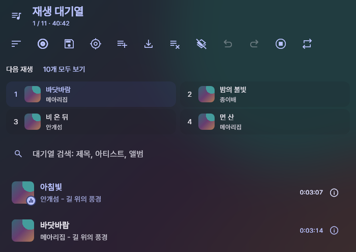
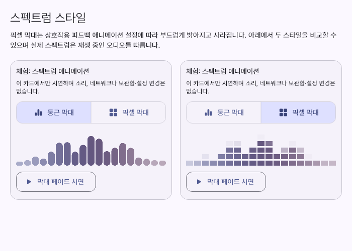
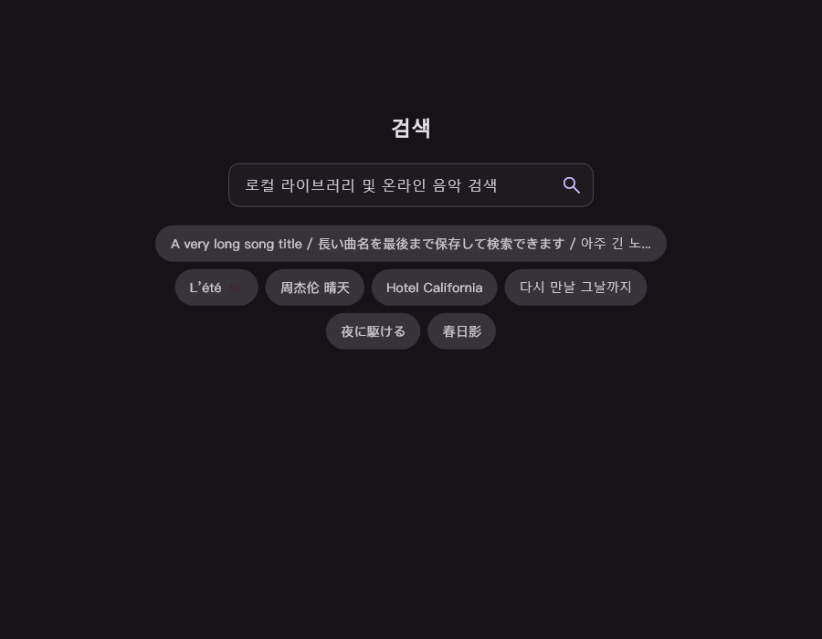
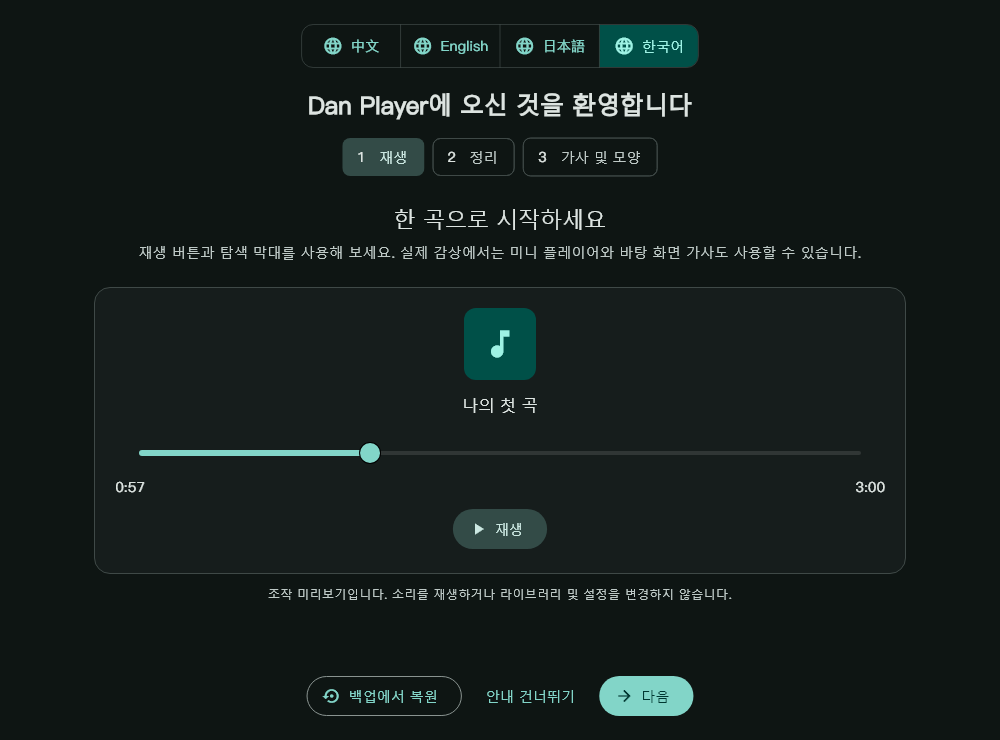
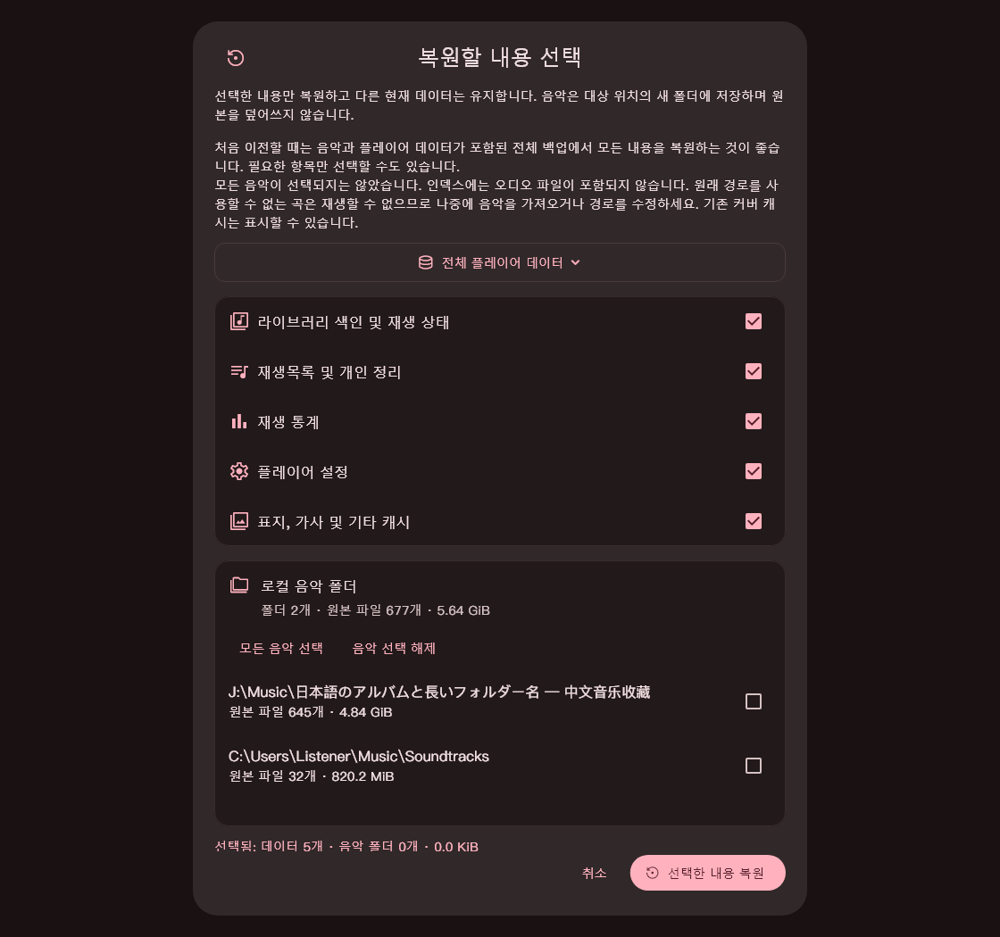

<div align="center">

<p>
  <picture>
    <source media="(prefers-color-scheme: dark)" srcset="docs/images/player-icon-dark.png">
    <source media="(prefers-color-scheme: light)" srcset="docs/images/player-icon-light.png">
    
  </picture>
</p>

<h1>Dan Player</h1>

<p><strong>나만의 로컬 음악 컬렉션을 위한 플레이어.</strong></p>

<p>라이브러리 정리, 가사 표시, 데스크톱 사용 경험을 갖춘 Windows x64 음악 플레이어입니다.<br>
로컬 재생을 중심으로 온라인 음악과 사용자 지정 소스도 지원합니다.</p>

<p align="center">
  <a href="https://github.com/DanRuguo/dan_player/releases/latest"></a>
  <a href="https://github.com/DanRuguo/dan_player/releases"></a>
  <a href="https://github.com/DanRuguo/dan_player/releases"></a>
  <a href="LICENSE"></a>
</p>

<p align="center">
  <a href="#download"></a>
  <a href="#development"></a>
  <a href="#development"></a>
  <a href="https://www.un4seen.com/bass.html"></a>
</p>

<p>
  <a href="https://github.com/DanRuguo/dan_player/releases/latest"><strong>안정 버전 다운로드</strong></a> ·
  <a href="https://github.com/DanRuguo/dan_player/releases">이전 릴리스</a> ·
  <a href="https://github.com/DanRuguo/dan_player/releases">변경 내용</a> ·
  <a href="https://github.com/DanRuguo/dan_player/issues/new/choose">문제 보고</a>
</p>

<p>
  <a href="README.md">简体中文</a> ·
  <a href="README.en.md">English</a> ·
  <a href="README.ja.md">日本語</a> ·
  <strong>한국어</strong>
</p>

</div>

<p align="center">
  <picture>
    <source media="(prefers-color-scheme: dark)" srcset="docs/images/library-dark-wide.png">
    <source media="(prefers-color-scheme: light)" srcset="docs/images/library-light-wide.png">
    
  </picture>
</p>

<p align="center">
  <a href="#download">다운로드</a> ·
  <a href="#features">특징</a> ·
  <a href="#screenshots">화면 미리 보기</a> ·
  <a href="#quick-start">시작하기</a> ·
  <a href="#development">개발 및 빌드</a>
</p>

<a id="download"></a>

## 다운로드 및 설치

| 버전 | 용도 | 다운로드 |
| --- | --- | --- |
| **최신 안정 버전** | 일상적인 사용과 업데이트. 버전은 릴리스 페이지에서 확인 | [설치 프로그램, 포터블 ZIP 및 체크섬](https://github.com/DanRuguo/dan_player/releases/latest) |

**설치 버전**은 설치 프로그램을 실행하면 되며, 기존 설치를 업데이트할 수 있습니다. **포터블 버전**은 ZIP 전체를 압축 해제한 뒤 `Dan Player.exe`를 실행하세요. EXE 파일만 따로 복사하지 마세요. 바탕 화면 가사는 동일한 실행 파일에서 별도 프로세스로 실행됩니다.

현재 포터블 ZIP에는 FFmpeg, 세 가지 오프라인 일본어 읽기 데이터(기본 사전·어휘 보충·한자 읽기 보충)와 라이선스가 포함되어 미리 듣기, 자르기와 오프라인 읽기 생성에 사용할 수 있습니다. 경량 설치 프로그램은 이 두 종류의 구성 요소를 제외하고 이미 설치한 것은 유지합니다. 플레이어에서 직접 받을 때도 고정 크기와 SHA-256을 검증합니다. FFmpeg는 [26.0.5의 별도 패키지](https://github.com/DanRuguo/dan_player/releases/tag/v26.0.5), 읽기 데이터는 [26.1.1 릴리스 페이지](https://github.com/DanRuguo/dan_player/releases/tag/v26.1.1)에서 각각 받을 수 있습니다.

> **다운로드 및 서명 안내:** 프로젝트에서 빌드한 실행 파일은 RCEIT.Inc 자체 서명 인증서를 사용하므로 Windows에 신뢰 관련 경고가 나타날 수 있습니다. 설치 프로그램은 신뢰할 수 있는 인증서를 자동으로 설치하지 않습니다. 이전 서명을 사용하는 버전에서 업데이트할 때는 새 설치 프로그램을 직접 다운로드하세요. 미리 보기 버전은 Latest로 표시된 안정 버전을 대체하지 않습니다. 업데이트 전에 앱의 백업 및 복원 설정에서 개인 데이터를 백업하는 것이 좋습니다.

<a id="download-verification"></a>

<details>
<summary><strong>SHA-256으로 다운로드 파일 확인</strong></summary>

같은 Release에서 프로그램과 해당 체크섬을 받으세요. 포터블 ZIP은 `SHA256SUMS`, 설치 프로그램은 같은 이름의 `.exe.sha256` 파일과 비교합니다. 파일의 SHA-256을 계산하고 GitHub 에셋 다이제스트도 확인하세요. 아래 파일명은 실제 다운로드한 파일명으로 바꾸세요.

```powershell
Get-FileHash -LiteralPath '.\DanPlayer-VERSION-Setup-x64.exe' -Algorithm SHA256
```

해시가 일치하면 공개된 배포 파일과 내용이 같다는 뜻이며, Windows가 서명 인증서를 신뢰한다는 뜻은 아닙니다. 다운로드 출처를 확인하고, 출처가 불분명한 파일을 실행하기 위해 시스템 보안 기능을 끄지 마세요.

</details>

<a id="features"></a>

## 특징

- **라이브러리와 검색:** 아티스트·앨범·형식·폴더별 탐색, 여러 단어·병음·오타 허용 검색, CUE 분할 트랙, 멀티 디스크 정렬, 메타데이터 일괄 편집과 라이브러리 상태 확인을 지원합니다.
- **재생목록과 대기열:** 계층형·스마트 재생목록, 드래그 정렬, 대기열 저장과 실행 취소. M3U／M3U8／PLS／XSPF의 로컬 오디오 참조를 가져오고 M3U8이나 음악 파일을 포함한 폴더로 내보낼 수 있습니다.
- **다음 재생:** 최대 네 곡의 반투명 카드를 넓은 창에서는 두 열, 좁은 창에서는 한 열로 표시합니다. 클릭하면 해당 대기열 항목으로 이동하며, 펼치면 순서가 정해진 최대 열 곡을 확인할 수 있습니다. 설정은 가사 화면의 미리 보기에만 적용되며 재생 막대의 팝업 목록에는 미리 보기가 없습니다.
- **재생과 구간:** 이퀄라이저, 음량 평준화, 독립적인 음높이 조절, 음높이를 유지하는 속도 변경, 곡별 이어 듣기, A–B 반복과 전체 북마크. 크로스페이드, 같은 앨범 내 크로스페이드 제외, 곡 앞뒤 무음 건너뛰기를 선택할 수 있습니다.
- **가사 편집과 읽기:** 단어 강조, 번역, 일본어 읽기, 전체 텍스트 검색과 시간 보정. 눌러서 타이밍을 지정하거나 텍스트로 편집하며, 수정본·잠금과 긴 가사의 루비 배치를 지원합니다.
- **커버와 분류:** 내장 이미지, 같은 폴더의 이미지, 움직이는 GIF를 지원합니다. 큰 재생 커버에는 부드러운 윤곽 빛과 국소 물방울 굴절 효과를, 분류 타일에는 빛 효과·여러 크기·사용자 정렬을 제공합니다.
- **스펙트럼과 움직임:** 진행 막대와 커버 테두리에 둥근 막대 또는 부드럽게 변하는 픽셀 스펙트럼을 표시합니다. 열 가지 애니메이션 설정, 동작 줄이기, 숨김 시 중지, 갱신율과 절전 설정을 공유하며 가이드에서 스펙트럼·진행·가사 효과를 체험할 수 있습니다.
- **데스크톱 경험:** 네 가지 언어, 밝고 어두운 테마, 커버 기반 색상, 단축키와 미니 플레이어. 바탕 화면·작업 표시줄 가사의 단어 강조, 작업 표시줄 한 줄·두 줄과 재생 버튼을 지원하며 두 가사 화면은 번갈아 표시합니다.
- **통계와 개인 정리:** 평점, 개인 태그, 청취 순위, 폴더 메모와 용량 내역. 컴필레이션은 앨범 아티스트로 묶고 음악·캐시를 구분하며 필요할 때 CPU／GPU／메모리 모니터링을 표시합니다.
- **백업과 복원:** 음악, 라이브러리, 재생목록, 통계, 설정, 캐시를 선택해 `.bak`에 저장합니다. 암호화, 선택 복원과 취소를 지원하며 공유 음악 파일은 중복 저장하지 않습니다.

가사와 댓글은 기본적으로 로컬 내용과 캐시를 우선 사용합니다. 자동 접속은 설정에서 켤 수 있으며 수동 검색·새로고침·일괄 캐시도 네트워크 요청을 보낼 수 있습니다.

온라인 음악과 사용자 지정 소스는 로컬 음악 감상을 보완합니다. 사용자 지정 서비스는 명시적으로 선언한 기능에 따라 검색이나 가사 등을 제공합니다. 연결 방법은 [사용자 지정 음악 소스 API](docs/custom-music-source-api.md)를 참고하세요.

메인·바탕 화면·작업 표시줄 가사는 글자 간격을 공유합니다. 생성한 일본어 읽기는 한자 위치에 표시하고 원본 가사와 기존 주석을 보존하며 별도의 파생 캐시에 저장합니다. 설정에서 저장된 가사를 일괄 처리할 수도 있습니다. 자동 접속이 켜져 있으면 온라인을 우선하고 실패 시 오프라인으로 전환합니다. 꺼져 있으면 가사 읽기 도구나 일괄 처리 창에서 온라인 또는 오프라인을 직접 선택해야 합니다. 온라인 생성에는 본인의 Yahoo! JAPAN Client ID가 필요하며 대상 텍스트를 해당 서비스에 전송합니다. 인증 정보는 이 컴퓨터에만 저장합니다. 오프라인 사전은 미등록 단어, 이름과 여러 발음이 있는 단어를 정확히 판별하지 못할 수 있으므로 결과를 확인하고 수정하세요.

<a id="screenshots"></a>

## 화면 미리 보기

### 다음 곡과 스펙트럼 가이드

실제 구성 요소를 한국어 UI와 가상 데이터로 렌더링했습니다. 스펙트럼은 가이드 시연이며 실시간 오디오 측정 결과가 아닙니다.

| 다음 네 곡의 반투명 카드 | 둥근 막대와 픽셀 스펙트럼 가이드 |
| --- | --- |
|  |  |

### 설명서와 필요할 때만 작동하는 모니터링

실제 구성 요소를 중국어 인터페이스로 렌더링한 예시입니다. 사용량과 경로는 가상 데이터입니다.

| 자주 쓰는 기능 안내 | 재생 대기열과 직접 조작하는 예시 |
| --- | --- |
|  |  |

| 여러 위치에서 리소스 모니터링 | 캐시 용량 분류 |
| --- | --- |
|  |  |

### 두 가지 가사 편집 방식

| 눌러서 타이밍 지정: 텍스트 준비 | 눌러서 타이밍 지정: 좁은 창에서 단어 기록 |
| --- | --- |
|  |  |

| 텍스트 편집: 가사 코드 | 텍스트 편집: 단어 미리 보기 |
| --- | --- |
|  |  |

### 나만의 방식으로 컬렉션 정리

| 재생목록 및 컬렉션 | 외관 및 설정 |
| --- | --- |
| <picture><source media="(prefers-color-scheme: dark)" srcset="docs/images/playlists-dark-wide.png"></picture> | <picture><source media="(prefers-color-scheme: dark)" srcset="docs/images/settings-dark-wide.png"></picture> |

### 듣고 싶은 곡을 찾고 가사에 집중

| 검색 및 기록 | 미니 플레이어 및 가사 |
| --- | --- |
|  |  |

### 청취 기록으로 라이브러리 다시 발견하기


<sub>실제 Flutter 위젯을 격리된 데모 데이터로 렌더링했습니다. 검색 이미지는 한국어 페이지의 콘텐츠 영역과 예시 기록이며, 네이티브 창 전체를 캡처한 화면이 아닙니다. 다른 예시는 주로 중국어 인터페이스를 사용합니다. 배치와 기능을 소개하는 이미지로, 실시간 오디오나 Windows 네이티브 효과의 검증 결과는 아닙니다. 테마, 창 너비, 4개 언어 예시는 <a href="docs/images/README.md">화면 갤러리</a>에서 확인하세요.</sub>

### 분류 타일과 시작 안내

<picture><source media="(prefers-color-scheme: dark)" srcset="docs/images/feature-category-tiles-dark.png"></picture>

| 첫 실행 안내: 언어 선택과 재생 조작 체험 | 플레이어 데이터와 로컬 음악 선택 복원 |
| --- | --- |
|  |  |

<a id="quick-start"></a>

## 시작하기

**음악 추가.** 음악 파일이나 폴더를 가져온 뒤 곡, 분류, 재생목록 화면에서 탐색하세요. 계층형 재생목록과 드래그 순서 변경으로 컬렉션을 정리할 수 있습니다.

**개인 평점과 태그 관리.** 분류 화면의 **개인 라이브러리 → 곡**에서 평점이나 개인 태그를 지정한 곡을 확인하고 날짜, 평점, 태그로 필터링할 수 있습니다. 개인 평점과 태그는 플레이어 데이터에 저장되며 **음악 파일에는 기록되지 않습니다**. 반면 메타데이터 편집과 태그 일괄 편집은 파일의 메타데이터를 변경하므로 저장 전에 변경 내용을 확인하세요.

**좋아하는 순간 저장.** 현재 재생 화면의 더 보기 메뉴에서 재생 북마크 창을 열어 현재 위치나 A–B 구간을 저장하세요. 저장한 항목은 분류 화면의 **개인 라이브러리 → 모든 북마크**에서 찾을 수 있습니다. 이 목록의 재생 버튼은 저장된 시작 위치부터 재생합니다. A–B 반복 구간을 복원하려면 해당 곡의 재생 북마크 창에서 그 구간을 선택하세요.

**데이터 백업.** 설정의 백업 및 복원 기능에서 플레이어 데이터와 로컬 음악을 선택해 저장할 수 있으며, 암호화와 선택 복원을 지원합니다. 프로그램 업데이트와 개인 데이터 백업은 서로 다른 작업입니다. 설치 폴더의 프로그램 파일은 라이브러리, 재생목록, 설정의 백업을 대신하지 않습니다.

큰 컬렉션은 폴더별로 나누세요. 암호를 안전하게 보관하고 암호화된 백업 하나는 약 64 GiB 미만으로 유지하세요.

<details>
<summary><strong>자주 사용하는 단축키</strong></summary>

| 키 | 동작 |
| --- | --- |
| `Space` | 재생 / 일시 정지 |
| `Ctrl + Left` / `Ctrl + Right` | 이전 곡 / 다음 곡 |
| `Left` / `Right` | 5초 뒤로 / 앞으로 이동 |
| `Ctrl + M` | 미니 플레이어 전환 |
| `F11` | 전체 화면 전환 |
| `F1` | 단축키 보기 |

</details>

<a id="documentation"></a>

## 문서 및 피드백

[화면 갤러리](docs/images/README.md) · [사용자 지정 음악 소스 API](docs/custom-music-source-api.md) · [go-music-api 설정 예시](docs/examples/go-music-api-jamendo.json) · [전체 릴리스](https://github.com/DanRuguo/dan_player/releases)

연결된 갤러리와 API 문서는 현재 중국어로 제공됩니다. 설정 예시의 서비스 주소는 직접 배포한 서비스 주소로 바꾸세요. 문제를 보고하기 전에 [기존 Issues](https://github.com/DanRuguo/dan_player/issues)를 확인한 뒤 [신고 양식](https://github.com/DanRuguo/dan_player/issues/new/choose)을 사용하세요. 플레이어 버전, 재현 단계, 필요한 경우 인터페이스 언어와 창 크기 또는 디스플레이 배율을 알려 주세요. 재생 문제에는 개인정보를 제거한 진단 자료를 첨부할 수 있습니다. 개인 음악 파일, 인증 정보, 개인 폴더의 전체 경로는 공개하지 마세요.

<a id="development"></a>

## 개발 및 빌드

**Flutter, Rust, BASS**를 사용합니다. 개발에는 Flutter, Rust, Visual Studio의 C++를 사용한 데스크톱 개발 워크로드가 필요합니다. Dart 버전 제약은 [pubspec.yaml](pubspec.yaml), 결정된 의존성 버전은 [pubspec.lock](pubspec.lock)과 [rust/Cargo.lock](rust/Cargo.lock)을 확인하세요. Windows 지속적 통합 워크플로는 [Windows CI](.github/workflows/windows_ci.yml)에 정의되어 있습니다.

<details>
<summary><strong>소스 구조, 디버깅 및 필요한 범위의 검사</strong></summary>

| 디렉터리 | 용도 |
| --- | --- |
| [lib/](lib/) | 기본 인터페이스, 라이브러리, 재생 서비스와 데이터 모델 |
| [third_party/desktop_lyric/](third_party/desktop_lyric/) | 공용 바탕 화면 가사, 글꼴과 Windows 호스트 |
| [rust/](rust/), [rust_builder/](rust_builder/) | 태그 처리, Flutter/Rust 연결과 Cargokit 지원 |
| [windows/](windows/), [installer/](installer/) | Windows 통합과 Inno 설치 프로그램의 네이티브 구성 요소 |
| [scripts/](scripts/) | 의존성 준비, 빌드, 서명과 산출물 검증 |
| [assets/](assets/), [shaders/](shaders/), [docs/](docs/) | UI 리소스, 셰이더, API 문서와 공개 이미지 |

일상적으로 사용하는 라이브러리와 설정에 영향을 주지 않도록 독립된 데이터 폴더를 지정하고 저장소 루트에서 실행하세요.

```powershell
$env:DAN_PLAYER_DATA_DIR = [IO.Path]::GetFullPath((Join-Path (Get-Location).Path '../tool/qa-local/readme-debug'))
flutter pub get
flutter run -d windows
```

실행 전에 BASS 런타임을 준비하세요. 관련 스크립트는 `scripts/prepare_bass_runtime.ps1`과 `scripts/prepare_bass_fx_runtime.ps1`입니다. 컴퓨터별 SDK, 캐시와 서명 경로는 소스 저장소에 넣지 않습니다.

현재 변경에 맞는 격리된 테스트 데이터를 준비하고 실제로 존재하는 진입점에서 필요한 Dart/Widget·Rust·Windows 검사를 실행하세요. 폐기된 과거 테스트 모음은 복원하지 않습니다. Dart는 `flutter test --no-pub <test-entry>`, Rust는 `cargo test --manifest-path rust/Cargo.toml --locked <test-filter>`를 사용합니다. 실제 UI 구성 요소로 영향을 받는 언어·창 너비·글자 크기를 확인하고, 네이티브 화면 수집에는 별도의 검증 창을 사용하세요. 위젯 렌더링은 실제 오디오 장치나 Windows 통합 검사를 대신하지 않습니다.

</details>

<details>
<summary><strong>Windows 빌드 및 배포</strong></summary>

릴리스 스크립트는 소스를 `dan_player/`, 같은 수준의 도구와 캐시를 `tool/`, 산출물을 `dist/`에 두는 구성을 사용합니다. `build_windows_release.ps1`은 의존성 준비, 재사용할 소스·산출물 기록 확인, Windows 빌드, 글꼴·런타임 검증과 선택적 서명·패키지 조립을 수행합니다. 변경 범위의 회귀 검사를 대신하지는 않습니다.

```powershell
# 위 작업 공간 구조에서 서명 인증서가 없는 경우, 소스 저장소에서 실행:
.\scripts\build_windows_release.ps1 -SkipSigning
```

`-SkipPackaging`은 포터블 패키지 조립을 건너뛰고, `-NoRestore`는 이미 복원된 의존성을 재사용합니다. 서명된 릴리스에는 별도의 인증서 설정이 필요합니다. 설치 프로그램은 `scripts/build_windows_installer.ps1`로 빌드하고, 포터블 패키지와 설치 프로그램은 각각 `verify_local_release.ps1`, `verify_windows_installer.ps1`로 검증합니다.

같은 코드 상태에서는 유효한 검사 결과와 빌드 결과물을 재사용하고, 실패 시 필요한 단계만 다시 실행하세요. 서명 후 소스 커밋, 테스트 검증 기록, 결과물 SHA-256 및 서명을 확인한 뒤 필요한 GitHub 배포 절차만 수행합니다. 미리 보기 버전은 prerelease로 유지하고 안정 버전의 Latest를 대체하지 않습니다. 절차를 줄이기 위해 필수 검증을 생략하지 마세요.

기본 로컬 패키지에는 FFmpeg가 포함되지 않습니다. 함께 넣으려면 `scripts/ffmpeg_runtime_manifest.json`에 지정된 런타임을 준비한 뒤 `scripts/assemble_windows_release.ps1 -IncludeOptionalComponents`를 사용하세요. `prepare_ffmpeg_runtime.ps1`은 기존 캐시를 검증하고 복사할 뿐 자동으로 다운로드하지 않습니다.

</details>

장기적으로 필요한 문서만 유지합니다. 로컬 개발 메모, 과거 QA 결과, 임시 로그, 도구 캐시, 개인 데이터, 서명 개인 키는 소스 저장소에 포함하지 않습니다. 공개 인터페이스 이미지는 `docs/images/`에 모으고, 이미지가 바뀌면 참조도 함께 업데이트합니다.

<a id="license"></a>

## 라이선스 및 감사의 말

이 프로젝트는 [LICENSE](LICENSE)에 따라 배포됩니다. 타사 구성 요소에는 각자의 라이선스 조건이 적용되며, BASS 사용과 배포는 공식 라이선스를 따라야 합니다.

메인 플레이어와 바탕 화면 가사는 같은 글꼴 리소스를 사용하며, 통합 선택, 4개 UI 언어별 선택 및 혼합 문자용 언어별 글꼴을 지원합니다. 내장 [Source Han Sans SC / JP](licenses/SOURCE-HAN-SANS/PROVENANCE.md), [Google Sans](licenses/GOOGLE-SANS/PROVENANCE.md), [Pretendard](licenses/PRETENDARD/PROVENANCE.md)는 SIL Open Font License 1.1에 따라 배포하며 원본 라이선스와 출처를 포터블 버전과 설치 프로그램에 함께 제공합니다. 내부 호환 별칭 `DanPingFangSC`는 Source Han Sans SC를 가리키며 Apple 글꼴을 포함하지 않습니다.

Dan Player는 [Ferry-200/coriander_player](https://github.com/Ferry-200/coriander_player)를 기반으로 개발되었습니다. 플레이어 기반, 라이브러리 구조, 가사 기능을 제공한 원작자에게 감사드립니다. 또한 [desktop_lyric](https://github.com/Ferry-200/desktop_lyric), [music_api_dart](https://github.com/Ferry-200/music_api_dart), [BASS](https://www.un4seen.com/bass.html), [Lofty](https://crates.io/crates/lofty), [flutter_rust_bridge](https://pub.dev/packages/flutter_rust_bridge), [Flutter](https://flutter.dev/), Material Design에 감사드립니다.

오프라인 사전 라이선스 및 출처: [IPADIC](licenses/IPADIC/PROVENANCE.md) / [EDRDG](licenses/EDRDG/PROVENANCE.md), [Lindera](licenses/LINDERA/LICENSE). 온라인 읽기: [Web Services by Yahoo! JAPAN](https://developer.yahoo.co.jp/sitemap/).

<sub>배지는 <a href="https://shields.io/">Shields.io</a>를 사용합니다. 다운로드 수는 Release 에셋의 다운로드 횟수이며 사용자 수나 설치 수가 아닙니다. 기술 배지는 사용 기술을 나타내며 최소 지원 버전을 의미하지 않습니다.</sub>
