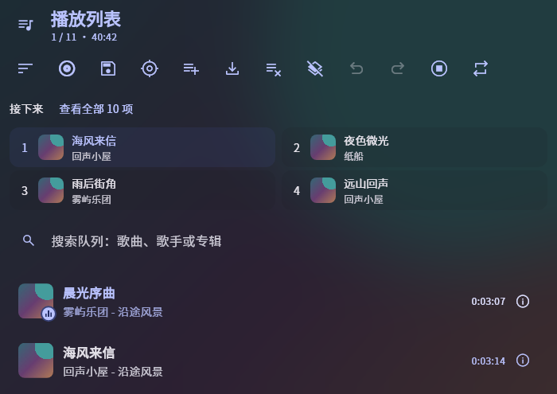
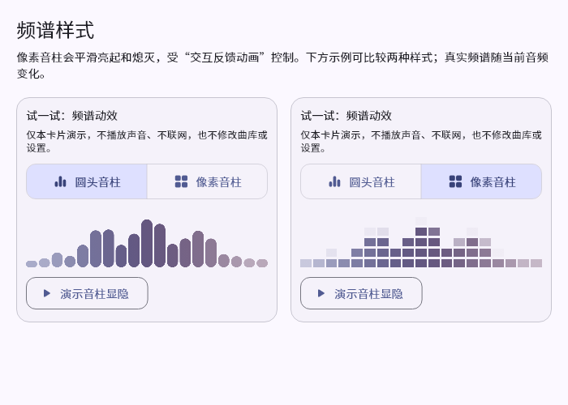
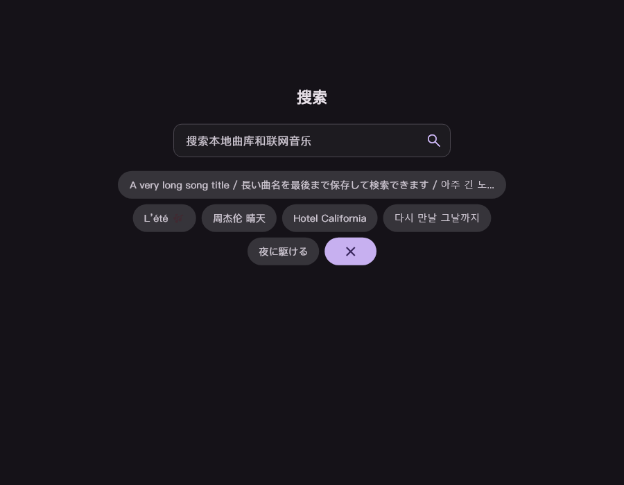
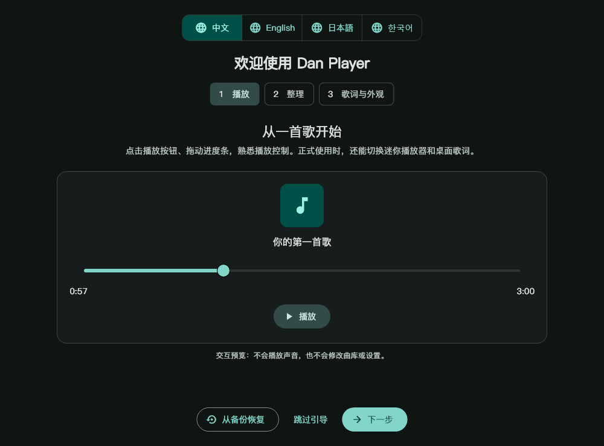
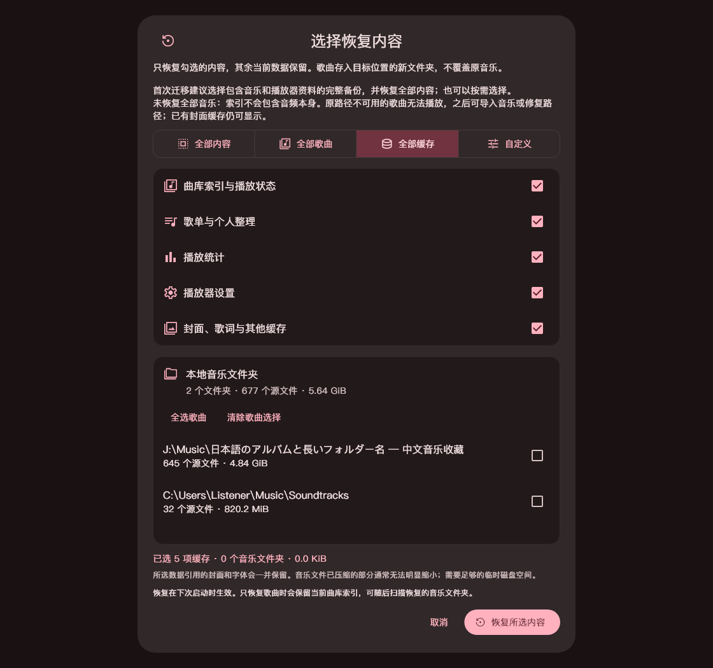

<div align="center">

<p>
  <picture>
    <source media="(prefers-color-scheme: dark)" srcset="docs/images/player-icon-dark.png">
    <source media="(prefers-color-scheme: light)" srcset="docs/images/player-icon-light.png">
    
  </picture>
</p>

<h1>Dan Player</h1>

<p><strong>为你的本地音乐收藏而设计。</strong></p>

<p>面向 Windows x64 的音乐播放器，兼顾曲库整理、歌词体验与桌面交互。<br>
以本地收听为核心，也支持联网音乐与自定义歌源。</p>

<p align="center">
  <a href="https://github.com/DanRuguo/dan_player/releases/latest"></a>
  <a href="https://github.com/DanRuguo/dan_player/releases"></a>
  <a href="https://github.com/DanRuguo/dan_player/releases"></a>
  <a href="LICENSE"></a>
</p>

<p align="center">
  <a href="#download"></a>
  <a href="#development"></a>
  <a href="#development"></a>
  <a href="https://www.un4seen.com/bass.html"></a>
</p>

<p>
  <a href="https://github.com/DanRuguo/dan_player/releases/latest"><strong>下载稳定版</strong></a> ·
  <a href="https://github.com/DanRuguo/dan_player/releases">历史版本</a> ·
  <a href="https://github.com/DanRuguo/dan_player/releases">更新记录</a> ·
  <a href="https://github.com/DanRuguo/dan_player/issues/new/choose">问题反馈</a>
</p>

<p>
  <strong>简体中文</strong> ·
  <a href="README.en.md">English</a> ·
  <a href="README.ja.md">日本語</a> ·
  <a href="README.ko.md">한국어</a>
</p>

</div>

<p align="center">
  <picture>
    <source media="(prefers-color-scheme: dark)" srcset="docs/images/library-dark-wide.png">
    <source media="(prefers-color-scheme: light)" srcset="docs/images/library-light-wide.png">
    
  </picture>
</p>

<p align="center">
  <a href="#download">下载与安装</a> ·
  <a href="#features">特色</a> ·
  <a href="#screenshots">界面一览</a> ·
  <a href="#quick-start">开始使用</a> ·
  <a href="#development">开发与构建</a>
</p>

<a id="安装与使用"></a>

<a id="download"></a>

## 下载与安装

| 版本 | 适用场景 | 下载 |
| --- | --- | --- |
| **最新稳定版** | 日常使用与升级，版本以发布页为准 | [安装器、便携 ZIP 与校验文件](https://github.com/DanRuguo/dan_player/releases/latest) |

**安装版**运行安装器，支持原位升级；**便携版**完整解压 ZIP 后运行 `Dan Player.exe`，不要只复制一个 EXE。桌面歌词由同一程序启动独立进程。

当前便携包包含 FFmpeg、三份离线日语注音数据（主词典、词汇补充、汉字读音补充）及许可，完整解压后即可用于试听、裁剪与离线注音。精简安装器不附带这两类组件，并保留已经安装的组件；也可从播放器中手动下载，校验固定大小和 SHA-256。FFmpeg 沿用 [26.0.5 的独立组件包](https://github.com/DanRuguo/dan_player/releases/tag/v26.0.5)，注音数据在 [26.1.1 发布页](https://github.com/DanRuguo/dan_player/releases/tag/v26.1.1)单独提供。

> **下载与签名说明**：自有程序使用 RCEIT.Inc 自签名证书，Windows 仍可能显示信任提示；安装器不会自动安装信任证书。旧签名版本请手动下载新安装器升级。预览版不替换稳定版 Latest；升级前建议通过播放器的“备份与恢复”保存个人资料。

<a id="下载校验"></a>
<a id="download-verification"></a>

<details>
<summary><strong>核对下载文件的 SHA-256</strong></summary>

从同一 Release 下载程序及对应校验文件：便携 ZIP 对照 `SHA256SUMS`，安装器对照同名 `.exe.sha256`。计算文件的 SHA-256，同时与 GitHub 资产摘要核对。将下面的占位文件名替换为实际下载文件名：

```powershell
Get-FileHash -LiteralPath '.\DanPlayer-版本号-Setup-x64.exe' -Algorithm SHA256
```

摘要一致表示文件内容与发布资产相符，不等同于 Windows 对签名证书的信任。请始终核对下载来源，不要通过关闭系统安全功能来处理来源不明的文件。

</details>

<a id="features"></a>

## 特色

- **曲库与搜索：** 按艺术家、专辑、格式和文件夹浏览，支持多词、拼音和容错搜索、CUE 分轨、多碟专辑排序、元数据批量编辑与曲库健康检查。
- **歌单与队列：** 嵌套歌单、智能条件、拖动排序、队列保存与撤销；导入 M3U／M3U8／PLS／XSPF 的本地音频引用，导出 M3U8 或连同音乐文件整理到文件夹。
- **接下来播放：** 最多四首半透明卡片，宽窗双列、窄窗单列，点击定位到对应队列项，展开可查看最多十首已确定的待播歌曲；设置仅控制歌词页预览，播放条弹出列表不显示预览。
- **播放与片段：** 均衡器、响度均衡、独立升降调、保持音高变速、逐曲续播、A–B 循环与全库书签；可选交叉淡化、同专辑免交叉，以及跳过曲首／曲尾静音。
- **歌词创作与阅读：** 逐字强调、翻译、日语假名、全文搜索和时间校准；快捷点按与传统文本两种编辑方式，支持修订、锁定及长行注音布局。
- **封面与分类：** 内嵌或同目录图片、动态 GIF 封面；播放大封面支持柔和轮廓辉光与局部水滴折射，分类磁贴保留流光、多种尺寸与自定义排列。
- **频谱与动效：** 进度条和封面频谱支持圆头音柱与平滑像素样式；共用十类动画管理、减少动画与隐藏停钟，提供刷新率及省电设置；特色指南可互动体验频谱、进度和歌词。
- **桌面体验：** 四语言、明暗主题、封面取色、快捷键与迷你播放器；桌面／任务栏歌词支持逐字强调，任务栏可选单双行和播放按钮，两种歌词互斥显示。
- **统计与个人整理：** 评分、个人标签、听歌排行、文件夹备注与占用统计；合辑按专辑艺术家归组，音乐与缓存分类清晰，CPU／GPU／内存监控按需显示。
- **备份与恢复：** 选择本地音乐、曲库、歌单、统计、设置与缓存保存为 `.bak`，支持密码加密、选择性恢复及取消；共享音乐文件去重保存。

歌词与评论默认优先读取本地内容和缓存；自动联网可在设置中开启，手动搜索、刷新与批量缓存仍可发起网络请求。

联网音乐与自定义歌源可作为本地曲库的补充。自定义服务按实际声明的能力提供检索、歌词等功能，接入方式见 [自定义歌源 API](docs/custom-music-source-api.md)。

歌词字间距由主歌词、桌面与任务栏共用。日语假名按汉字位置显示，保留原歌词和已有注音，仅保存独立的派生缓存；设置中也可批量处理已缓存歌词。自动联网开启时优先联网、失败回退离线；关闭时需在阅读工具或批量窗口明确选择联网或离线。联网注音需配置自己的 Yahoo! JAPAN Client ID，选用联网时会将待注音文本发送给该服务；凭据只保存在本机。 离线词典对未知词、人名和多音字的识别有局限，可检查并修订结果。

<a id="screenshots"></a>

## 界面一览

### 待播预览与频谱指南

以下使用实际组件、中文界面及虚构数据渲染；频谱是指南演示，不是实时音频采样。

| 四首半透明待播卡片 | 圆头音柱与像素频谱互动指南 |
| --- | --- |
|  |  |

### 说明书与按需监控

以下是实际组件的中文界面渲染，资源数值及目录为示例数据。

| 常用操作说明 | 播放队列与互动演示 |
| --- | --- |
|  |  |

| 多处资源监控 | 缓存分类占用 |
| --- | --- |
|  |  |

### 两种歌词编辑方式

| 快捷点按：准备文本 | 快捷点按：窄窗逐字打点 |
| --- | --- |
|  |  |

| 传统码字：歌词代码 | 传统码字：逐字预览 |
| --- | --- |
|  |  |

### 整理收藏，也保留自己的使用习惯

| 歌单与收藏 | 外观与设置 |
| --- | --- |
| <picture><source media="(prefers-color-scheme: dark)" srcset="docs/images/playlists-dark-wide.png"></picture> | <picture><source media="(prefers-color-scheme: dark)" srcset="docs/images/settings-dark-wide.png"></picture> |

### 找到想听的歌曲，专注眼前的歌词

| 搜索页与历史 | 迷你播放器与歌词 |
| --- | --- |
|  |  |

### 从收听记录重新认识自己的曲库


<sub>图片使用实际 Flutter 控件与隔离演示数据；搜索图展示页面内容区域和示例历史，不是完整原生窗口截图。图片用于展示布局与功能，不代表实时音频或原生桌面效果测试。更多明暗主题、宽窄窗口和四语言示例见 <a href="docs/images/README.md">界面图库</a>。</sub>

### 分类磁贴与首次迁移

<picture><source media="(prefers-color-scheme: dark)" srcset="docs/images/feature-category-tiles-dark.png"></picture>

| 首次引导：选择语言并体验播放控制 | 选择恢复内容：播放器资料与本地音乐 |
| --- | --- |
|  |  |

<a id="quick-start"></a>

## 开始使用

**添加音乐。** 导入音乐文件或文件夹后，在音乐、分类和歌单页浏览；使用嵌套歌单与拖动排序组织收藏。

**整理个人偏好。** 进入“分类 → 个人整理 → 歌曲”，查看评过分或添加过个人标签的歌曲，并按日期、评分、标签筛选。个人评分和标签保存在播放器资料中，**不会写入音乐文件**；“编辑信息”和“批量编辑标签”则会修改文件元数据，保存前请核对变更预览。

**记住喜欢的片段。** 在正在播放页面的“更多 → 播放书签”中保存当前位置或 A–B 片段，再到“分类 → 个人整理 → 全库书签”集中查找。全库书签中的播放按钮从保存的起点播放；恢复片段循环时，在对应歌曲的“播放书签”中选择该 A–B 书签。

**备份自己的资料。** 设置中的“备份与恢复”可按需保存播放器资料和本地音乐，并支持加密及选择性恢复。程序升级与资料备份是不同操作，安装目录中的程序文件不能替代曲库、歌单与设置备份。

备份可按文件夹拆分；请妥善保存密码，单个加密备份须小于约 64 GiB。

<details>
<summary><strong>常用快捷键</strong></summary>

| 按键 | 操作 |
| --- | --- |
| `Space` | 播放／暂停 |
| `Ctrl + Left` / `Ctrl + Right` | 上一首／下一首 |
| `Left` / `Right` | 后退／前进 5 秒 |
| `Ctrl + M` | 切换迷你播放器 |
| `F11` | 切换全屏 |
| `F1` | 查看快捷键 |

</details>

<a id="documentation"></a>

## 文档与反馈

[界面图库](docs/images/README.md) · [自定义歌源 API](docs/custom-music-source-api.md) · [go-music-api 配置示例](docs/examples/go-music-api-jamendo.json) · [全部发行版本](https://github.com/DanRuguo/dan_player/releases)

配置示例中的服务地址需要替换为自己部署的地址。遇到问题时，请先查看 [已有 Issues](https://github.com/DanRuguo/dan_player/issues)，再通过 [反馈模板](https://github.com/DanRuguo/dan_player/issues/new/choose) 提交播放器版本、复现步骤，以及相关界面语言、窗口大小或显示缩放。播放问题可附脱敏诊断；请不要上传私人音乐文件、凭据或完整个人目录。

<a id="源码与构建"></a>
<a id="development"></a>

## 开发与构建

基于 **Flutter、Rust 与 BASS**。需要 Flutter、Rust 和 Visual Studio 桌面 C++ 工作负载；Dart 约束见 [pubspec.yaml](pubspec.yaml)，依赖版本以 [pubspec.lock](pubspec.lock) 与 [rust/Cargo.lock](rust/Cargo.lock) 为准。Windows 持续集成入口见 [Windows CI](.github/workflows/windows_ci.yml)。

<details>
<summary><strong>源码结构、调试与定向检查</strong></summary>

| 目录 | 用途 |
| --- | --- |
| [lib/](lib/) | 主界面、曲库、播放服务与数据模型 |
| [third_party/desktop_lyric/](third_party/desktop_lyric/) | 共用的桌面歌词组件、字体资源与 Windows 宿主 |
| [rust/](rust/)、[rust_builder/](rust_builder/) | 标签处理、Flutter/Rust 桥接与 Cargokit 构建支持 |
| [windows/](windows/)、[installer/](installer/) | Windows 集成与 Inno 安装器原生组件 |
| [scripts/](scripts/) | 依赖准备、构建、签名与产物校验 |
| [assets/](assets/)、[shaders/](shaders/)、[docs/](docs/) | 界面资源、着色器、接口说明与公开图片 |

在仓库根目录执行，使用独立资料目录，避免调试影响日常曲库与设置：

```powershell
$env:DAN_PLAYER_DATA_DIR = [IO.Path]::GetFullPath((Join-Path (Get-Location).Path '../tool/qa-local/readme-debug'))
flutter pub get
flutter run -d windows
```

运行前需准备 BASS 运行库，见 `scripts/prepare_bass_runtime.ps1` 与 `scripts/prepare_bass_fx_runtime.ps1`。本机 SDK、缓存和签名路径不放入源码仓库。

按当前改动准备隔离夹具，选择实际存在的入口做定向 Dart/Widget、Rust 或 Windows 验证；不恢复已退役的历史测试集合。Dart 使用 `flutter test --no-pub <测试入口>`，Rust 使用 `cargo test --manifest-path rust/Cargo.toml --locked <测试筛选>`。UI 应用真实组件核对直接受影响的语言、窗宽和文字缩放；原生采帧使用独立验收窗口。控件渲染不替代真实音频设备或 Windows 桌面集成检查。

</details>

<details>
<summary><strong>Windows 构建与发行</strong></summary>

现有发布脚本使用工作区布局：源码在 `dan_player/`，同级 `tool/` 放置工具链和缓存，`dist/` 接收产物。`build_windows_release.ps1` 准备依赖、核对可复用来源与产物、编译 Windows 程序、检查字体及运行库，并按参数签名或组装；它不代替定向回归验证。

```powershell
# 使用上述工作区布局，在源码仓库运行；无签名证书时：
.\scripts\build_windows_release.ps1 -SkipSigning
```

`-SkipPackaging` 跳过便携包组装；`-NoRestore` 使用已恢复的依赖。正式签名需要单独配置证书。安装器使用 `scripts/build_windows_installer.ps1`，便携包和安装器分别由 `verify_local_release.ps1`、`verify_windows_installer.ps1` 核验。

同一代码状态复用已通过的检查与构建产物，失败只重试必要阶段；签名后核对源码提交、测试收据、产物 SHA-256 与签名，再执行必要的 GitHub 发布流程。预览版保持 prerelease，不替换稳定版 Latest，不以省略校验来精简流程。

本地默认组装不包含 FFmpeg。需要随包附带时，先按 `scripts/ffmpeg_runtime_manifest.json` 准备固定运行库，再用 `scripts/assemble_windows_release.ps1 -IncludeOptionalComponents` 组装。`prepare_ffmpeg_runtime.ps1` 只校验并复制已有缓存，不自动下载。

</details>

仅维护必要的长期文档。本机开发笔记、历史 QA、临时日志、工具缓存、个人资料和签名私钥不进入源码仓库；公开界面资源集中在 `docs/images/`，随资源变更同步维护引用。

<a id="license"></a>

## 许可证与致谢

本项目按 [LICENSE](LICENSE) 分发；第三方组件保留各自许可，BASS 的使用与分发须遵守其官方许可。

主程序与桌面歌词共用一份字体资源，支持统一选择、四语言分别选择，以及混合文字按语种使用字体。内置 [思源黑体 SC／JP](licenses/SOURCE-HAN-SANS/PROVENANCE.md)、[Google Sans](licenses/GOOGLE-SANS/PROVENANCE.md) 和 [Pretendard](licenses/PRETENDARD/PROVENANCE.md)，均按 SIL Open Font License 1.1 分发；原版许可与来源随便携包和安装器提供。`DanPingFangSC` 内部兼容别名对应思源黑体 SC，不包含苹果字体。

Dan Player 基于 [Ferry-200/coriander_player](https://github.com/Ferry-200/coriander_player) 修改，感谢原作者提供的播放器基础、曲库结构和歌词体验。同时感谢 [desktop_lyric](https://github.com/Ferry-200/desktop_lyric)、[music_api_dart](https://github.com/Ferry-200/music_api_dart)、[BASS](https://www.un4seen.com/bass.html)、[Lofty](https://crates.io/crates/lofty)、[flutter_rust_bridge](https://pub.dev/packages/flutter_rust_bridge) 及 [Flutter](https://flutter.dev/) 与 Material Design。

离线假名字典的许可与来源见 [IPADIC](licenses/IPADIC/PROVENANCE.md) / [EDRDG](licenses/EDRDG/PROVENANCE.md) 和 [Lindera](licenses/LINDERA/LICENSE)。联网注音：[Web Services by Yahoo! JAPAN](https://developer.yahoo.co.jp/sitemap/)。

<sub>徽章由 <a href="https://shields.io/">Shields.io</a> 提供。下载量统计 Release 附件的下载次数，不等于用户数或安装量；技术徽章仅说明使用的技术，不声明最低支持版本。</sub>
